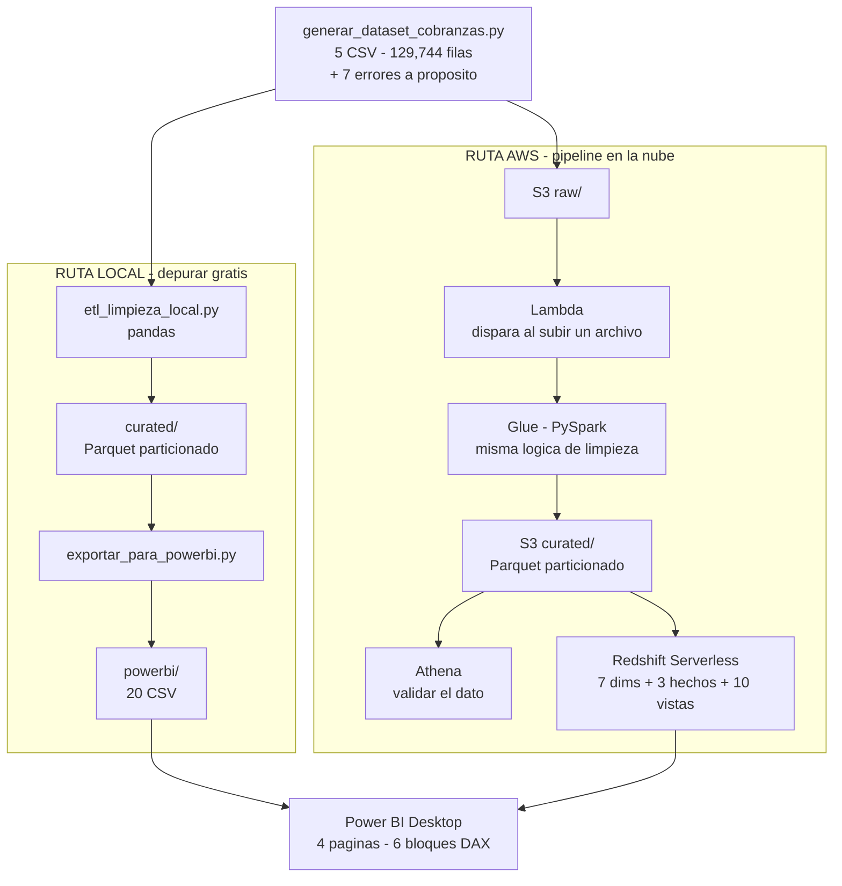

# Cobranzas Analytics — Pipeline de datos end-to-end en AWS

> **De 5 CSV sucios a un tablero de recuperación de cartera.**
> Ingesta, limpieza, modelado dimensional y visualización, con **verificación en cada capa**:
> 17 chequeos de calidad en la capa curada, 14 de auditoría en el modelo y los mismos
> conteos en Athena y en Redshift.

Dataset **sintético** de 5,000 clientes y 18 meses de operación (129,744 filas), con 7 errores
inyectados a propósito para demostrar el tratamiento de datos sucios.

---

## Diagrama de procesos



> **Nota:** este Mermaid evita `direction` dentro de los subgraph y las directivas
> `style`, porque algunos renderizadores (incluido el de Miro) no las soportan.

### Versión en texto (para cualquier editor)

```
                    generar_dataset_cobranzas.py
                    5 CSV · 129,744 filas · 7 errores
                                 |
              +------------------+------------------+
              |                                     |
        RUTA LOCAL                             RUTA AWS
      (depurar gratis)                   (pipeline en la nube)
              |                                     |
   etl_limpieza_local.py                       S3  raw/
          (pandas)                                |
              |                              Lambda (dispara)
        curated/  Parquet                         |
              |                                Glue  (PySpark)
   exportar_para_powerbi.py                       |
              |                            S3  curated/  Parquet
     powerbi/  20 CSV                      +------+------+
              |                           |             |
              |                      Athena         Redshift
              |                    (validar)   (modelo estrella
              |                                  + 10 vistas)
              |                                     |
              +------------------+------------------+
                                 |
                        Power BI Desktop
                     4 paginas · 6 bloques DAX
```

---

## Version con iconos oficiales de AWS

`diagrama_arquitectura.py` genera el mismo flujo con los **iconos reales de cada servicio**
(S3, Lambda, Glue, Athena, Redshift), usando la libreria `diagrams` + Graphviz.

```powershell
winget install -e --id Graphviz.Graphviz
pip install --user diagrams
python diagrama_arquitectura.py      # genera .png y .svg
```

**Usa el SVG** para presentaciones o para Miro: es vectorial y no se pixela al ampliar.

---

## Las 5 capas

| # | Capa | Que hace | Donde vive | Evidencia |
|---|---|---|---|---|
| 1 | **Origen** | Genera 5 tablas relacionales con errores a proposito | `raw/` | 5,025 clientes · 6,254 creditos · 71,229 cuotas · 25,689 gestiones · 21,547 snapshots |
| 2 | **Raw en la nube** | Almacena el CSV tal como llega, todo STRING | `s3://…/raw/` | 5 tablas en Athena con los conteos exactos |
| 3 | **Curada** | Aplica 7 reglas de limpieza y escribe Parquet | `curated/` (local y S3) | **17 chequeos en 0** · 78% menos bytes que el CSV |
| 4 | **Modelo** | Modelo dimensional con claves subrogadas | Redshift | **14/14 chequeos de auditoria** · cuadres de importes exactos |
| 5 | **Consumo** | Vistas de negocio y tablero | `powerbi/` y Power BI | 20 CSV · 10 vistas · **KPI identicos en Athena, Redshift y Power BI** |

---

## Decisiones que se defienden en una entrevista

| Decision | Por que |
|---|---|
| **Raw = todo STRING** | Los errores inyectados rompen los tipos estrictos: declarar DATE o DECIMAL haria fallar la consulta. Raw es texto sin validar; curated ya tiene tipos |
| **Parquet + particion por anio** | Columnar y comprimido (78% menos). Athena cobra por TB escaneado, asi que leer menos columnas cuesta menos |
| **Dos ETL identicos (pandas + PySpark)** | La logica se depura gratis en local; solo se sube cuando funciona. Depurar en Glue cuesta tiempo y dinero |
| **Staging antes del modelo estrella** | El `COPY` de Redshift mapea **por posicion**: una lista de columnas desordenada corrompe los datos en silencio |
| **Power BI Desktop, no QuickSight** | QuickSight cuesta $24/mes fijo que no baja por usar poco; Power BI Desktop es gratis |
| **Redshift Serverless con apagado manual** | $1.50/hora encendido. Se enciende, se trabaja y **se elimina el workgroup** al terminar |
| **Sin NAT Gateway** | ~$32/mes solo por existir |
| **La Lambda no va en la VPC** | Mismo motivo: evita el costo de red |

---

## Numeros del proyecto

| Metrica | Valor |
|---|---|
| Filas totales | **129,744** en 5 tablas |
| Compresion CSV → Parquet | **78%** (11.37 MB → 2.46 MB) |
| Chequeos de calidad (capa curada) | **17 en 0** |
| Chequeos de auditoria (modelo) | **14/14 OK** |
| Vistas de negocio | **10** |
| Cartera vencida sin gestionar | **195 creditos · S/ 87,770** |
| Cumplimiento de PTP | **52.55%** |
| Costo por sol recuperado | **S/ 0.0268** |
| Costo real del proyecto | **menos de $1** |
