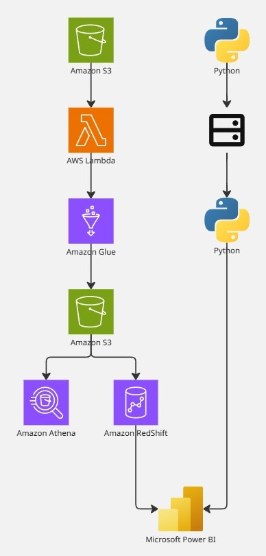

# AWS_Cobranzas — Pipeline de datos de cobranzas

<p align="center">
  
</p>

Este proyecto construye **desde cero y sobre AWS** el entorno analítico que una fintech de crédito
de consumo necesita para gestionar su cobranza. El punto de partida son 5 archivos CSV que simulan
los sistemas de origen —clientes, créditos, cuotas, gestiones de cobranza y snapshots diarios de
mora— y que llegan **con errores inyectados a propósito**: fechas de pago futuras, montos
negativos, claves huérfanas, cuotas duplicadas y montos alterados. Eso es deliberado: un pipeline
que solo funciona con datos limpios no demuestra nada.

El recorrido reproduce el de un proyecto real de datos:

1. **Ingesta** — los CSV llegan a S3 sin transformar, en una capa `raw` donde **todo es texto**.
   No es descuido: declarar tipos estrictos rompe la consulta al toparse con una fila sucia.
2. **Limpieza** — un ETL aplica **7 reglas de negocio** y escribe Parquet columnar particionado por
   año. Está implementado **dos veces con la misma lógica**: en pandas (local, para depurar gratis)
   y en PySpark sobre Glue (en la nube, para ejecutar de verdad).
3. **Validación** — 17 chequeos de calidad, cuadres de importes y validación de claves, ejecutados
   tanto en local como en Athena sobre el lago.
4. **Modelado** — un **modelo estrella** en Redshift Serverless: 7 dimensiones, 3 tablas de hechos
   con claves subrogadas, `DISTKEY`/`SORTKEY`, y 10 vistas de negocio listas para consumir.
5. **Visualización** — un **tablero de 4 páginas** en Power BI que responde cuatro preguntas de
   negocio: ¿cómo se deteriora la cartera?, ¿qué canal recupera más por cada sol invertido?,
   ¿se cumplen las promesas de pago?, y **¿qué cartera vencida nadie está gestionando?**

El resultado se verifica en cada capa: los conteos son **idénticos en las tres**, y los 38 KPI del
tablero coinciden con los que devuelven Redshift y Athena.

---

## Estado

| Capa | Estado |
|---|---|
| Dataset sintético (129,744 filas, 7 errores inyectados) | ✅ |
| Limpieza local (pandas) | ✅ 17 chequeos en 0 |
| S3 · `raw/` + `curated/` | ✅ 11.37 MB |
| Glue (PySpark) | ✅ ejecutado, conteos idénticos |
| Athena | ✅ 6 validaciones + 4 consultas de negocio |
| Redshift: modelo estrella + 10 vistas | ✅ **14/14 auditoría · workgroup apagado** |
| Tablero Power BI (4 páginas, 38 medidas) | ✅ montado |
| Lambda de automatización | ⏳ código listo y 10 pruebas pasando, pendiente de desplegar |

**Costo real del proyecto: menos de $1.** Ver la sección de costos.

---

## El tablero

| | |
|---|---|
|  |  |
| **1 · Resumen ejecutivo** | **2 · Aging y evolución de la mora** |
|  |  |
| **3 · Efectividad de la gestión** | **4 · Priorización de la cartera** |

El archivo es `Proyecto.pbix`. Abre con **Power BI Desktop** (gratis) y **no necesita AWS**:
consume los 20 CSV de la carpeta `powerbi/`.

---

## Cómo reproducirlo paso a paso

### Fase 0 — Seguridad de la cuenta (solo la primera vez)

Lee `aws/00_seguridad_cuenta.md` y completa el checklist: usuario IAM con permisos mínimos,
MFA, y **Budgets con alerta** antes de crear cualquier recurso que cobre.

### Fase 1 — Generar y limpiar los datos (local, gratis)

```powershell
python generar_dataset_cobranzas.py --out raw     # 2.6 segundos

cd aws
python etl_limpieza_local.py                      # genera ../curated/
python verificar_curated.py                       # los 17 chequeos deben dar 0
python preflight.py                               # 25 chequeos de entorno
```

### Fase 2 — Pipeline en AWS

```powershell
cd aws
.\01_setup_s3.ps1 -Contacto "bruno"   # bucket + cifrado + bloqueo público
.\02_subir_datos.ps1                  # sube y verifica byte a byte
.\03_crear_glue_job.ps1               # rol IAM + job + crawler de curated
.\04_ejecutar_job.ps1                 # ejecuta, espera y reporta el costo
```

**Athena:** ejecuta los archivos de `aws/athena_ddl/` (12, una sentencia cada uno) y después los de
`aws/athena_val/` (11). Están divididos así porque **la consola de Athena solo acepta una sentencia
por ejecución**.

**Redshift** (crea el workgroup antes y **elimínalo al terminar**):

```powershell
.\08_ejecutar_redshift.ps1 -Sql "05_redshift_schema_estrella.sql"
.\08_ejecutar_redshift.ps1 -Sql "06_redshift_carga_ejecutar.sql"
.\08_ejecutar_redshift.ps1 -Sql "07_redshift_vistas_negocio.sql"
```

Si un SQL falla, añade `-UnaPorUna`: ejecuta cada sentencia en su propia sesión y aísla el error.

### Fase 3 — Exportar y montar el tablero

```powershell
python exportar_para_powerbi.py       # genera ../powerbi/ (20 CSV)
```

Luego sigue `GUIA_POWER_BI.md`: 10 CSV → 14 relaciones → 38 medidas DAX → 4 páginas.

⚠️ **Los `vw_*.csv` no se cargan en el modelo.** Son resultados ya calculados, para **contrastar**
las medidas DAX. Si los metes, tendrás dos caminos al mismo número.

---

## Verificaciones (lo que debe cuadrar)

| Comprobación | Valor |
|---|---|
| Filas en las 3 capas (raw, curated, Redshift) | 5,000 / 6,254 / 71,229 / 25,689 / 21,547 |
| Chequeos de la capa curada | **17 en 0** |
| Auditoría del modelo estrella | **14/14 `cumple: true`** |
| Saldo por cobrar | **S/ 529,563.89** |
| Saldo vencido (último corte) | **S/ 410,836.49** |
| Costo por sol recuperado | **S/ 0.0268** |
| Cartera vencida sin gestionar | **S/ 87,770.20** (195 créditos) |

---

## Costos

| Servicio | Uso real | Costo |
|---|---|---|
| Glue | 276 DPU-segundos | ~$0.034 |
| Crawler | 40.4 s | ~$0.01 |
| S3 + Athena | 13.6 MB | ~$0.0001 |
| Redshift Serverless | minutos, **workgroup eliminado** | según uso |
| Lambda | free tier | $0 |

**Disciplina aplicada:** sin NAT Gateway (~$32/mes solo por existir), Lambda fuera de la VPC,
logs con retención corta, Redshift con auto-pause y **workgroup eliminado al terminar**.

**Nota:** el namespace de Redshift conserva los datos y, con él, un secreto de Secrets Manager de
unos céntimos al mes. Para costo cero absoluto hay que eliminar también el namespace.

---

## Estructura del repositorio

```
.
├── README.md                      <- este archivo
├── ARQUITECTURA.md                <- diagrama, capas y decisiones de diseno
├── PRESENTACION_PROYECTO.md       <- documento de portafolio
├── GUIA_POWER_BI.md               <- relaciones, DAX y las 4 paginas
├── FUENTES_Y_DICCIONARIO_DATOS.md
├── capturas/                      <- portada + las 4 paginas del tablero
├── powerbi/                       <- 20 CSV que consume el tablero
├── Proyecto.pbix                  <- el tablero
├── generar_dataset_cobranzas.py   <- genera los 5 CSV sinteticos
├── validar_dataset.py             <- auditoria de calidad del dataset
└── aws/                           <- todo lo de AWS (empieza por 00_seguridad_cuenta.md)
```

**`raw/` y `curated/` no se versionan**: se regeneran en segundos con los dos comandos de la
Fase 1, y así el repositorio no arrastra 30 MB de datos derivados. Los CSV de `powerbi/` sí están
incluidos porque son los que necesita el tablero para abrirse sin AWS.

---

## Las trampas que ya están resueltas

Estas son las seis que costaron más tiempo. Cada una está resuelta en el código:

1. **PowerShell 5.1 borra las comillas dobles** al pasar JSON a ejecutables nativos → usar `file://`
2. **`fct_mora_diaria` es un snapshot diario** (77 cortes): sumar sin `LASTDATE` da 30× el valor
3. **Power BI interpreta el punto como separador de miles** → todos los importes ×100
4. **Power BI autodetecta relaciones** entre columnas del mismo nombre y crea ciclos → solo 14 relaciones por `*_key`
5. **Redshift no soporta `ISODOW` ni `RESTART IDENTITY`** → usar `DOW` y quitar el `RESTART`
6. **`COPY` mapea columnas por posición**, no por nombre → staging intermedio obligatorio
